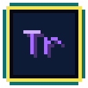

<!-- amigo-labs header: generated by amigo-labs/website scripts/readme-header.ts -->

  

<h1 align="center">Trommel</h1>

  
  
  
  

<!-- /amigo-labs header -->

Game audio authoring: sample-based voices, Strudel patterns and engine integration for the Amigo Engine. In planning; the specs start at [`docs/specs/audio/_index.md`](docs/specs/audio/_index.md).
